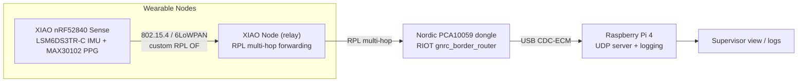

# Privacy-Preserving Wearable IoT Mesh

An intelligent, privacy-preserving wearable IoT mesh for physiological monitoring and indoor localization — built on [RIOT OS](https://www.riot-os.org/), with a custom RPL objective function and on-device TinyML for alert classification.

M.Tech thesis project, Amrita School of Computing (Knowledge Engineering and Semantic Computing research group).

## Overview

Target environments: elderly care facilities, autism hostels, and off-grid industrial sites where continuous physiological monitoring matters but cloud connectivity and centralized data collection are undesirable or unavailable.

Core technical pillars:

- **On-device TinyML** — a two-stage edge classifier: an IMU-based fall detector (Stage 1, the only ML stage) followed by a PPG-based rule check for alert severity (Stage 2), run entirely on the node.
- **Custom RPL Objective Function** — routing that factors in health urgency, residual battery, and IMU-derived mobility, so a node raising an alert gets routing priority over idle neighbors.
- **IEEE 802.15.4 / 6LoWPAN mesh** — a self-organizing, multi-hop mobile mesh with a beacon/DODAG root node for supervisor-side visibility.
- **No cloud dependency** — all inference and routing decisions happen on-device or at a local border router; no raw physiological data leaves the local mesh.

## System architecture

- **Nodes**: Seeed XIAO nRF52840 Sense (onboard IMU) + MH-ET LIVE MAX30102 PPG breakout, running RIOT OS.
- **Border router**: Nordic PCA10059 nRF52840 USB dongle running `gnrc_border_router`, plugged into a Raspberry Pi 4 which is a downstream logging/supervisor host only (RPL/6LoWPAN logic lives on the dongle, not the Pi).
- See [`docs/ARCHITECTURE.md`](docs/ARCHITECTURE.md) for the full breakdown.

## Repository structure

| Path | Contents |
|---|---|
| `firmware/` | RIOT custom applications — IMU/PPG drivers, fall-detection module, RPL relay app |
| `border-router/` | Border router build notes and the Pi 4 UDP server (`hr_reply_server.py`) |
| `ml/fall-detection/` | Training pipeline for the on-device fall-detection classifier (SisFall-based) |
| `hardware/` | Enclosure design, power/battery notes, bill of materials |
| `docs/` | Architecture write-up, installation guide, results |

## Getting started

See [`docs/INSTALLATION.md`](docs/INSTALLATION.md) for toolchain setup, flashing the nodes, and bringing up the border router + Pi 4.

## Current status

- End-to-end bidirectional communication confirmed: node → RPL mesh → border router → Pi 4 → ACK back to node.
- Custom MAX30102 driver built from scratch against RIOT's `periph/i2c.h` (no native RIOT driver existed); heart-rate extraction via DC-baseline EMA subtraction + peak detection, stable at 1 Hz.
- RPL mesh rank/loss piggybacked on every data packet; verified live against `nib route` and `tcpdump`.
- Outdoor range characterization complete: usable link out to ~55 m (50–60% loss at that distance) in open line-of-sight.
- Multi-hop RPL relay (second node as an intermediate hop) in progress, moving from a hardcoded relay address toward fully automatic RPL-native multi-hop.
- Fall-detection model (Stage 1, IMU-only): logistic regression on 9 magnitude/tilt features, trained on the full SisFall dataset (38 subjects), ~95% trial-level fall recall with a post-trigger stillness-confirmation rule to cut false alarms. C export validated against the Python reference.
- PPG severity check (Stage 2) and the custom RPL objective function are the next implementation milestones.

## Roadmap

- Finish the native multi-hop RPL path (automatic join/leave, no hardcoded addresses) and re-run the range/multi-hop test outdoors.
- Implement the custom RPL Objective Function (health urgency + battery + mobility) against RIOT's pluggable OF interface.
- Adaptive Trickle timer behavior triggered by IMU-detected movement.
- Merge the IMU fall module with the PPG severity check into a unified on-node alert pipeline.
- Multi-node mesh expansion and a comparative benchmark against commercial wearables.

## License

MIT — see [`LICENSE`](LICENSE).
