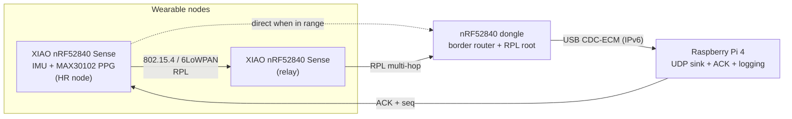

# Edge-Intelligent Health Monitoring over Adaptive Low-Power and Lossy Networks

**Privacy-preserving wearable IoT mesh**: wrist-worn nodes that measure heart rate, carry an embedded fall detector, and report over a self-organizing IEEE 802.15.4 / 6LoWPAN / RPL mesh, built on [RIOT OS](https://www.riot-os.org/). No cloud, and no raw physiological data leaves the local network.

M.Tech (Artificial Intelligence) thesis project, Amrita School of Computing, Amrita Vishwa Vidyapeetham, Coimbatore
Knowledge Engineering and Semantic Computing (KESC) research group
Author: **G Tanush Adithiya** · Supervisor: **Dr. M. Senthilkumar**

**Project site:** https://sapphire-rapid.github.io/privacy-preserving-wearable/ (interactive ward simulation)
**Documentation:** https://sapphire-rapid.github.io/privacy-preserving-wearable/docs/

## Why

Elderly-care facilities, autism hostels and off-grid industrial sites need continuous physiological monitoring, but often have poor connectivity and good reasons not to stream health data to a cloud. This project keeps both inference and routing on the devices:

- **On-node edge AI**: the IMU fall detector is plain C sized for the wearable, so only an *alert* has to cross the network. It matches the Python reference on the host; validation on the band itself is the next step.
- **Self-organizing mesh**: nodes join, leave and re-parent automatically over RPL, so a worker or resident who walks out of the border router's range is still reachable through other nodes.
- **Local only**: the border router and a Raspberry Pi 4 on site are the only infrastructure.

## System architecture

| Layer | Implementation |
|---|---|
| Node hardware | Seeed XIAO nRF52840 Sense (LSM6DS3TR-C IMU) + MH-ET LIVE MAX30102 PPG, 250 mAh LiPo, 3D-printed wrist case |
| OS | RIOT OS (Contiki-NG and Zephyr were evaluated first: Contiki-NG did not run on this board, and Zephyr's RPL could not be extended) |
| Network | IEEE 802.15.4 (O-QPSK, 250 kbps) · 6LoWPAN · RPL · UDP |
| Border router | Nordic PCA10059 dongle running a custom `gnrc_border_router` build (`firmware/mesh/mesh_br`) |
| Sink | Raspberry Pi 4, Python UDP server with per-node packet-loss tracking and CSV logging |
| Edge AI | Logistic-regression fall detector (9 IMU features, 2 s windows) exported to C |

## Results

| What | Result |
|---|---|
| End-to-end path | Node → RPL → border router → Pi 4 → ACK back to node, bidirectional, with the RPL rank carried in every packet and packet loss tracked per node |
| Heart rate | MAX30102 driver written from scratch on RIOT `periph/i2c.h` (no in-tree driver); DC-baseline removal + peak detection, 100 Hz sampling |
| Range (single hop, +8 dBm) | About 4–5% loss at 5 m and 13–17% at 25 m (line of sight, USB-tethered); 50–60% loss at about **55 m** outdoors, the farthest distance tested |
| Fall detection (SisFall, 38 subjects, subject-wise nested CV, trial level) | **94.9% fall recall**, 9.8% ADL false-alarm rate, with a 3 s post-impact stillness confirmation |
| Model footprint | 9 coefficients + intercept (plus per-feature scaling); C export matches the Python reference on every test vector |
| Mesh firmware | Border router configures its uplink and RPL root on boot (no manual shell steps); a DIS keeper lets nodes find a parent without a power-cycle; Thread-like Trickle (Imax about 33 s); floating DODAGs disabled |

Fall-detection metrics, sweep tables and plots: [`ml/fall-detection/results/`](ml/fall-detection/results/).

## Repository structure

| Path | Contents |
|---|---|
| [`firmware/mesh/`](firmware/mesh/) | **Current firmware.** One node image (`ROLE=hr` or `ROLE=relay`), border router, Pi 4 sink server, shared RPL/radio tuning |
| [`firmware/fall_imu/`](firmware/fall_imu/) | Stage-1 fall detector port to the XIAO: exported model and feature code, host test harness, DRDY-gated IMU sampling |
| `firmware/max30102_probe/`, `imu_test/`, `relay_node/` | Earlier single-purpose apps used to validate each subsystem in isolation |
| [`ml/fall-detection/`](ml/fall-detection/) | Python pipeline: SisFall features, training, nested evaluation, C export |
| [`border-router/`](border-router/) | Original Pi 4 UDP server (superseded by `firmware/mesh/server/mesh_server.py`) |
| [`hardware/`](hardware/) | Bill of materials, wiring, power, stack order, enclosure notes |
| [`docs/`](docs/) | Architecture, installation and the documentation-site sources (MkDocs, served at `/docs/`) |
| [`website/`](website/) | Project landing page: static HTML/CSS/JS with the interactive ward simulation, no build step |

## Getting started

1. Toolchain and RIOT checkout: [`docs/INSTALLATION.md`](docs/INSTALLATION.md)
2. Build and flash the mesh: [`firmware/mesh/README.md`](firmware/mesh/README.md)
3. Retrain or re-export the fall model: [`ml/fall-detection/README.md`](ml/fall-detection/README.md)

## Future work

- Alert-priority routing: a custom RPL Objective Function in which only a node with an active edge-AI alert changes parent selection, and other nodes give way to it
- Stage-2 severity check: a PPG heart-rate rule after a detected fall (critical vs. fall-only)
- On-device validation of the fall detector with recordings from the XIAO itself, and an own heart-rate dataset
- Multi-node, multi-hop field evaluation and comparison against commercial wearables
- Adaptive Trickle timing driven by IMU-detected movement

## Citation

If you use this work, please cite it using [`CITATION.cff`](CITATION.cff) (GitHub's "Cite this repository" button).

## License

MIT. See [`LICENSE`](LICENSE). The SisFall dataset is not redistributed here; see [`ml/fall-detection/data/README.md`](ml/fall-detection/data/README.md).
