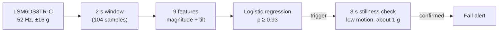
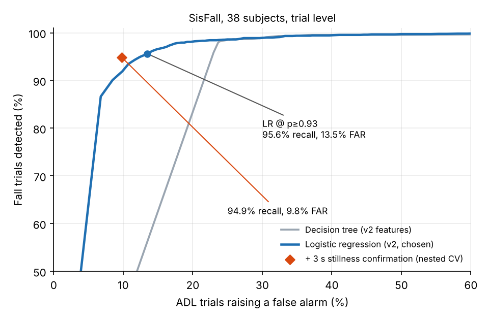

# Fall detection (on-node edge AI)

The detector is designed to run on the wearable, so only the resulting alert travels over the mesh. Today it is exported to C and verified against the Python reference on the host; validation on the band itself is the next step.

## Pipeline

1. **Stage 1, IMU (machine learning):** every 2 s window of accelerometer data is reduced to 9 features (magnitude statistics, jerk, low-g count, and the tilt change between before and after the impact) and scored by a logistic-regression model.
2. **Confirmation:** a trigger only becomes an alert if the wearer then stays still for 3 s, as a person who has fallen typically does. This removes most false alarms from sitting down hard or similar movements.
3. **Stage 2, PPG (rule):** a heart-rate check after the fall will classify the alert as *critical* or *fall-only* (future work).

## Why logistic regression

Neural models (a TinyCNN on PPG data) did not reach the accuracy target. Classical models on hand-designed features did. Logistic regression gave the best recall/false-alarm trade-off at the trial level, and it fits on the node as 9 coefficients plus an intercept. The C export reproduces the Python model's output on every test vector.

## Training pipeline



Dataset notes and rebuild steps: [`ml/fall-detection/data/README.md`](https://github.com/sapphire-rapid/privacy-preserving-wearable/blob/main/ml/fall-detection/data/README.md)
