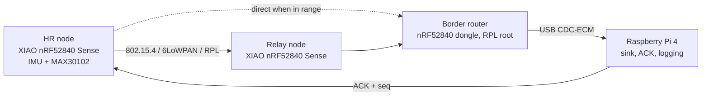

# Edge-Intelligent Health Monitoring over Adaptive Low-Power and Lossy Networks

**A privacy-preserving wearable IoT mesh.** Wrist-worn nodes measure heart rate, detect falls on the device itself, and report over a self-organizing IEEE 802.15.4 / 6LoWPAN / RPL mesh built on RIOT OS. The site needs no cloud, and raw physiological data never leaves it.

[View the code on GitHub](https://github.com/sapphire-rapid/privacy-preserving-wearable){ .md-button .md-button--primary } [How it works](ARCHITECTURE.md){ .md-button }

---

## The problem

Elderly-care facilities, autism hostels and off-grid industrial sites need continuous monitoring of the people in them. These sites often have weak connectivity, and good reasons not to stream health data to a cloud service. A wearable that only talks to a single gateway also loses contact as soon as its wearer walks out of range.

## The approach

- **On-node edge AI.** A logistic-regression fall detector runs on the wearable's own IMU data, so only an *alert* has to cross the network.
- **Self-organizing mesh.** Nodes join, leave and re-parent automatically over RPL, so a node out of the gateway's range is reached through other nodes.
- **Local only.** One nRF52840 border-router dongle and a Raspberry Pi 4 on site are the entire infrastructure.

## Key results

| Area | Result |
|---|---|
| **End-to-end** | Node → RPL mesh → border router → Pi 4 → ACK back to the node, with RPL rank and packet loss in every packet |
| **Range** | 55 m open-field ceiling at +8 dBm with on-board chip antennas |
| **Fall detection** | 94.9% of SisFall fall trials detected at a 9.8% ADL false-alarm rate (38 subjects, subject-wise nested CV) |
| **Footprint** | Fall model is 9 coefficients + intercept; node firmware is about 72 KB |

Details on the [Results](results.md) page.

## Built with

Seeed XIAO nRF52840 Sense · MH-ET LIVE MAX30102 · Nordic PCA10059 · Raspberry Pi 4 · RIOT OS · Python / scikit-learn

---

M.Tech (Artificial Intelligence) thesis project by **G Tanush Adithiya**, supervised by **Dr. M. Senthilkumar**. Knowledge Engineering and Semantic Computing (KESC) research group, Amrita School of Computing, Amrita Vishwa Vidyapeetham, Coimbatore.
