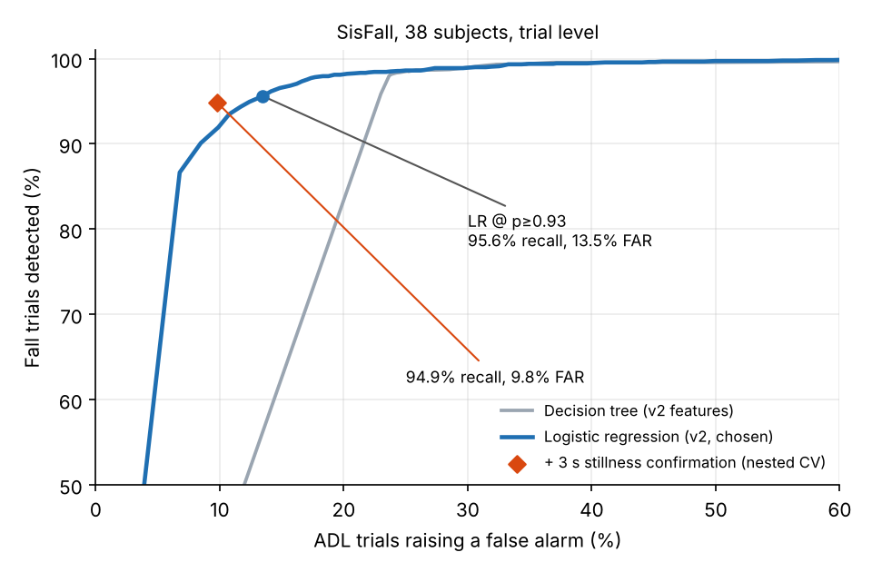

# Results

## End-to-end communication

- Bidirectional path verified: node → RPL mesh → border router → Raspberry Pi 4 → `ACK` back to the node.
- Every packet carries the node's sequence number, heart rate and current RPL rank. The Pi 4 sink tracks packet loss per node and per session, so loss counts stay correct across RPL rejoins.
- Verified live against the border router's routing table and a `tcpdump` capture on the Pi 4.

## Radio range (single hop)

Conditions: XIAO nRF52840 Sense on battery, +8 dBm TX on both ends, on-board chip antennas, node held away from the body, line of sight.

| Distance | Packet loss |
|---|---|
| 5 m | about 4–5% |
| 25 m | about 13–17% |
| 55 m (open field, ceiling) | 50–60% |

The link degrades gradually rather than failing suddenly. That makes multi-hop relaying through other wearers a better way to extend coverage than antenna modifications, which this form factor does not allow.

!!! note "Lessons from field testing"
    - A USB-tethered node browns out and resets when the cable is pulled, so every range test runs on battery.
    - At 2.4 GHz, a hand or the wearer's body, or a nearby laptop chassis, can cut the link completely. Mount the node away from both.

## Fall detection

Dataset: SisFall, 38 subjects (23 young, 15 elderly), 4505 trials, ADXL345 resampled to 52 Hz.
Protocol: subject-wise 5-fold **nested** cross-validation. Thresholds are chosen on the inner folds only, and results are reported per trial.

| Metric | Value |
|---|---|
| Fall trials detected (recall) | **94.9%** (1706 / 1798) |
| ADL trials with a false alarm | **9.8%** (264 / 2702) |
| ADL false-alarm rate, elderly subjects | 2.9% |
| Model size | 9 coefficients + intercept |

Raw sweep tables and per-fold results: [`ml/fall-detection/results/`](https://github.com/sapphire-rapid/privacy-preserving-wearable/tree/main/ml/fall-detection/results)

## Future work

- Alert-priority routing: a custom RPL Objective Function in which only a node with an active alert changes parent selection
- PPG severity stage after a detected fall
- On-device validation with the XIAO's own recordings, and an own heart-rate dataset
- Multi-node, multi-hop field evaluation and comparison with commercial wearables
